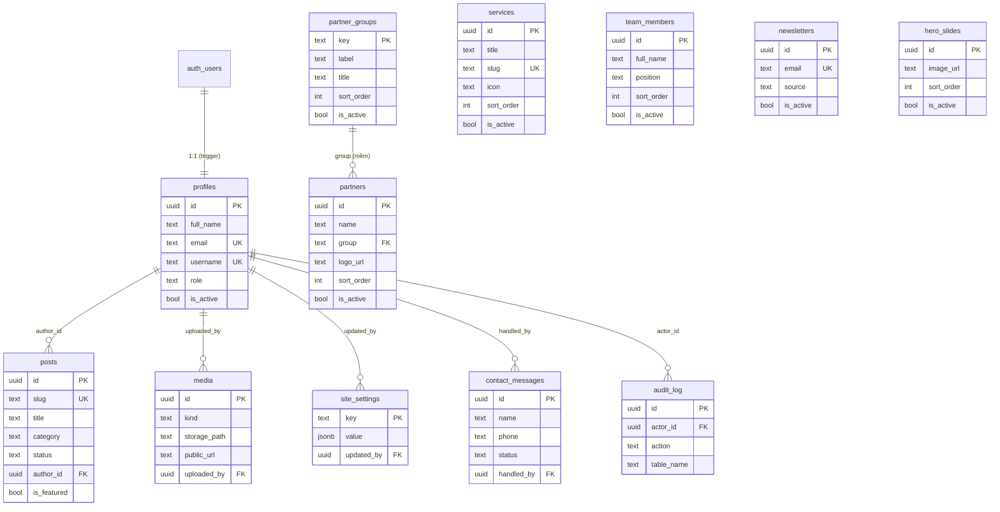

# Website CBO SÁT CÁNH

Website chính thức của **Tổ chức Dựa vào Cộng đồng CBO SÁT CÁNH** — giới thiệu tổ chức,
dịch vụ, hoạt động và tiếp nhận thông tin từ cộng đồng.

- Thành lập: 04/12/2022
- Lĩnh vực: y tế cộng đồng & thiện nguyện xã hội (chăm sóc sức khỏe, phòng chống HIV/AIDS)
- Fanpage: **CBO SÁT CÁNH** · Hotline: **0967.206.095 – 0396.433.095**
- Email: **satcanhkg68@gmail.com**

> Toàn bộ giao diện và nội dung bằng **tiếng Việt**.

---

## Giới thiệu

Đây là một website + **CMS (hệ quản trị nội dung)** chạy hoàn toàn trên web. Quản trị viên
có thể tự sửa mọi thứ — bài viết, dịch vụ, đối tác, đội ngũ, banner trang chủ, màu giao diện —
**mà không cần đụng tới mã nguồn**.

**Trang khách:**

- Trang chủ dạng một trang cuộn (anchor) với banner slider, dịch vụ, đối tác, đội ngũ, bài nổi bật…
- Trang tin tức + trang chi tiết bài viết (nội dung Markdown).
- Trang liên hệ: form gửi câu hỏi + bản đồ Google Maps.
- Form đăng ký nhận tin (newsletter).

**Trang quản trị `/admin`** với 3 vai trò và các màn hình:

| Màn hình | URL | Nội dung |
| --- | --- | --- |
| Dashboard | `/admin` | Thẻ thống kê, câu hỏi mới nhất |
| Bài viết & Tin tức | `/admin/bai-viet` | Soạn Markdown, ảnh bìa, SEO, nháp/xuất bản |
| Dịch vụ | `/admin/dich-vu` | Sắp xếp kéo-thả, icon, màu, bật/tắt |
| Đối tác | `/admin/doi-tac` | Logo theo nhóm, link website |
| Đội ngũ | `/admin/doi-ngu` | Họ tên, chức danh, ảnh, tiểu sử |
| Nội dung tĩnh | `/admin/noi-dung` | Hero, tầm nhìn, sứ mệnh, giá trị, liên hệ, footer |
| Banner (Slider) | `/admin/slider` | CRUD slide, crop ảnh 16:7 |
| Giao diện | `/admin/giao-dien` | Đổi hệ màu, áp dụng cho toàn site |
| Quản lý ảnh | `/admin/anh` | Upload Storage, chuẩn hoá link ngoài |
| Câu hỏi liên hệ | `/admin/cau-hoi` | Xem / đánh dấu đã trả lời |
| Newsletter | `/admin/newsletter` | Danh sách, xuất CSV |
| Tài khoản & vai trò | `/admin/tai-khoan` | Tạo user, đổi vai trò, khoá |
| Hồ sơ cá nhân | `/admin/ho-so` | Avatar, tên đăng nhập, mật khẩu |

---

## Công nghệ sử dụng

| Thành phần | Lựa chọn |
| --- | --- |
| Framework | **Next.js 16** (App Router, Turbopack, React Compiler) |
| Ngôn ngữ | **TypeScript** |
| Giao diện | **Tailwind CSS v4** |
| Font | **Be Vietnam Pro** (Google Fonts) |
| Database / Auth / Storage | **Supabase** (PostgreSQL, Supabase Auth, Storage) |
| Markdown | **react-markdown** + **remark-gfm** |
| Crop ảnh | **react-easy-crop** |
| Icon | **lucide-react** |
| Triển khai | **Vercel** |
| Bản đồ | Google Maps embed (iframe) |

---

## Kiến trúc tổng quan

```
        Khách truy cập ──►  Vercel (Next.js 16, SSR/ISR)
                              ├─ /            Trang chủ
                              ├─ /tin-tuc     Tin tức + chi tiết
                              ├─ /lien-he     Liên hệ
                              ├─ /admin       CMS (bảo vệ bởi proxy.ts)
                              └─ /api/*       API route
                                     │
                ┌────────────────────┼────────────────────┐
                ▼                    ▼                    ▼
          Supabase             Google Sheets         (Storage ảnh)
       PostgreSQL · Auth      (bản sao form,        bucket site-assets
       · Storage · RLS         qua Apps Script)
```

**Luồng form liên hệ:** `Form → POST /api/contact → INSERT vào Supabase (bản chính) → đẩy sang
Google Sheets (bản sao) → trả về thành công`.

---

## Cấu trúc thư mục

```
web/
├─ app/
│  ├─ layout.tsx                 # Font, theme, metadata
│  ├─ globals.css                # Biến CSS của hệ màu
│  ├─ page.tsx                   # Trang chủ (một trang cuộn)
│  ├─ tin-tuc/                   # Danh sách + chi tiết bài viết
│  ├─ lien-he/                   # Liên hệ + form + bản đồ
│  ├─ admin/                     # CMS
│  │  ├─ login/                  # Đăng nhập
│  │  └─ (protected)/            # Các màn hình sau đăng nhập
│  └─ api/                       # contact, newsletter, newsletter-csv
├─ components/
│  ├─ site/                      # Header, Hero, HeroSlider, Footer, Form…
│  └─ admin/                     # Editor, form, bảng, ImageCropper, ui.tsx…
├─ lib/
│  ├─ supabase/                  # client, server, admin, update-session
│  ├─ auth.ts                    # requireRole(), getUser()
│  ├─ content.ts                 # Truy vấn nội dung + dữ liệu mặc định
│  ├─ settings.ts                # Đọc site_settings (theme, hero, footer…)
│  ├─ theme.ts                   # Ghép hệ màu động
│  ├─ sheets.ts                  # Gửi Apps Script
│  └─ drive-link.ts              # Chuẩn hoá link ảnh ngoài
├─ supabase/
│  ├─ migrations/                # File SQL (đánh số theo thời gian)
│  └─ seed.sql                   # Dữ liệu khởi tạo
├─ public/                       # favicon, ảnh tĩnh (brand, partners)
├─ docs/                         # Tài liệu dự án đầy đủ (tiếng Việt)
├─ proxy.ts                      # Thay middleware: refresh session + bảo vệ /admin
└─ next.config.ts
```

> **Lưu ý Next.js 16:** `middleware` đã được đổi tên thành **`proxy`** — xem `proxy.ts`.

---

## Cơ sở dữ liệu

Toàn bộ dữ liệu nằm trong **Supabase (PostgreSQL)**, bảo vệ bằng **RLS**. Ảnh lưu ở Storage
bucket **`site-assets`**. Định nghĩa schema nằm trong [`supabase/migrations/`](./supabase/migrations).

### Sơ đồ quan hệ (ERD)



> `auth.users` do Supabase Auth quản lý; `profiles` là bản hồ sơ 1:1 mở rộng.
> `storage.objects` (bucket `site-assets`) lưu tệp ảnh, liên kết mềm với `media.public_url`.
> `partners.group` trỏ mềm tới `partner_groups.key` (không ràng buộc khóa ngoại cứng).

### Từ điển dữ liệu

**`profiles`** — hồ sơ nhân sự (1:1 với `auth.users`)

| Cột | Kiểu | Ghi chú |
| --- | --- | --- |
| `id` | uuid | PK, trỏ `auth.users.id` (CASCADE) |
| `full_name` | text | Họ tên |
| `email` | text | Duy nhất |
| `username` | text | Duy nhất (không phân biệt hoa/thường), để đăng nhập |
| `role` | text | `admin` \| `editor` \| `collaborator` (mặc định `collaborator`) |
| `avatar_url` | text | Ảnh đại diện |
| `is_active` | bool | Khoá/mở tài khoản (mặc định `true`) |
| `created_at` / `updated_at` | timestamptz | Tự cập nhật |

**`posts`** — bài viết / tin tức

| Cột | Kiểu | Ghi chú |
| --- | --- | --- |
| `id` | uuid | PK |
| `slug` | text | Duy nhất, dùng cho URL |
| `title` | text | Tiêu đề |
| `excerpt` | text | Tóm tắt |
| `content_md` | text | Nội dung Markdown |
| `cover_url` | text | Ảnh bìa |
| `category` | text | `tin-tuc` \| `hoat-dong` |
| `status` | text | `draft` \| `published` |
| `author_id` | uuid | FK → `profiles.id` (SET NULL) |
| `is_featured` | bool | Nổi bật ở trang chủ |
| `meta_title` / `meta_description` | text | SEO |
| `published_at` | timestamptz | Ngày xuất bản |

**`services`** — dịch vụ

| Cột | Kiểu | Ghi chú |
| --- | --- | --- |
| `id` | uuid | PK |
| `title` | text | Tên dịch vụ |
| `slug` | text | Duy nhất |
| `description` | text | Mô tả |
| `icon` | text | Tên icon (lucide) |
| `color` | text | Màu thẻ |
| `sort_order` | int | Thứ tự hiển thị |
| `is_active` | bool | Bật/tắt |

**`partners`** + **`partner_groups`** — đối tác theo nhóm

| `partner_groups` | Kiểu | Ghi chú |
| --- | --- | --- |
| `key` | text | PK (vd `strategic`, `clinic`, `network`) |
| `label` / `title` / `subtitle` | text | Nhãn hiển thị |
| `sort_order` / `is_active` | int / bool | Thứ tự, bật/tắt |

| `partners` | Kiểu | Ghi chú |
| --- | --- | --- |
| `id` | uuid | PK |
| `name` | text | Tên đối tác |
| `group` | text | Trỏ `partner_groups.key` |
| `logo_url` / `website_url` | text | Logo, website |
| `sort_order` / `is_active` | int / bool | Thứ tự, bật/tắt |

**`team_members`** — đội ngũ

| Cột | Kiểu | Ghi chú |
| --- | --- | --- |
| `id` | uuid | PK |
| `full_name` / `position` | text | Họ tên, chức danh |
| `avatar_url` / `bio` | text | Ảnh, tiểu sử |
| `sort_order` / `is_active` | int / bool | Thứ tự, bật/tắt |

**`site_settings`** — nội dung tĩnh & hệ màu (key/jsonb)

| Cột | Kiểu | Ghi chú |
| --- | --- | --- |
| `key` | text | PK: `theme`, `hero`, `about`, `vision`, `mission`, `values`, `contact`, `footer`, `map`, `seo` |
| `value` | jsonb | Dữ liệu theo khóa |
| `updated_at` / `updated_by` | timestamptz / uuid | Ai sửa, khi nào |

**`hero_slides`** — banner trang chủ

| Cột | Kiểu | Ghi chú |
| --- | --- | --- |
| `id` | uuid | PK |
| `image_url` | text | Ảnh slide (16:7) |
| `alt` | text | Mô tả ảnh |
| `sort_order` / `is_active` | int / bool | Thứ tự, bật/tắt |

**`media`** — thư viện ảnh

| Cột | Kiểu | Ghi chú |
| --- | --- | --- |
| `id` | uuid | PK |
| `kind` | text | `hero` \| `banner` \| `decoration` \| `logo` \| `avatar` \| `other` |
| `storage_path` / `public_url` | text | Đường dẫn trong bucket, URL công khai |
| `alt` | text | Mô tả ảnh |
| `uploaded_by` | uuid | FK → `profiles.id` (SET NULL) |

**`contact_messages`** — câu hỏi từ form liên hệ

| Cột | Kiểu | Ghi chú |
| --- | --- | --- |
| `id` | uuid | PK |
| `name` / `phone` / `email` | text | Người gửi |
| `service_interest` / `message` | text | Dịch vụ quan tâm, nội dung |
| `status` | text | `new` \| `replied` \| `archived` |
| `source` | text | Nguồn gửi |
| `handled_by` | uuid | FK → `profiles.id` (SET NULL) |

**`newsletters`** — đăng ký nhận tin

| Cột | Kiểu | Ghi chú |
| --- | --- | --- |
| `id` | uuid | PK |
| `email` | text | Duy nhất |
| `name` | text | Tên (tuỳ chọn) |
| `source` | text | Nơi đăng ký (mặc định `footer`) |
| `is_active` | bool | Còn nhận tin hay không |

**`audit_log`** — nhật ký thao tác (giai đoạn 2)

| Cột | Kiểu | Ghi chú |
| --- | --- | --- |
| `id` | uuid | PK |
| `actor_id` | uuid | FK → `profiles.id` (SET NULL) |
| `action` | text | Hành động |
| `table_name` / `record_id` / `payload` | text / uuid / jsonb | Đối tượng bị tác động |

### Khóa ngoại

| Bảng | Cột | Trỏ tới | Khi xoá |
| --- | --- | --- | --- |
| `profiles` | `id` | `auth.users.id` | CASCADE |
| `posts` | `author_id` | `profiles.id` | SET NULL |
| `media` | `uploaded_by` | `profiles.id` | SET NULL |
| `site_settings` | `updated_by` | `profiles.id` | SET NULL |
| `contact_messages` | `handled_by` | `profiles.id` | SET NULL |
| `audit_log` | `actor_id` | `profiles.id` | SET NULL |
| `partners` | `group` | `partner_groups.key` | (mềm) |

### Bảng phân quyền RLS

Vai trò lấy từ `profiles.role` (qua các hàm `is_admin()`, `is_editor()`, `is_staff()`).

| Bảng | SELECT | INSERT | UPDATE | DELETE |
| --- | --- | --- | --- | --- |
| `profiles` | bản thân / admin | admin | bản thân / admin | admin |
| `posts` | `published` hoặc staff | admin, editor | admin, editor | admin |
| `services` | `is_active` hoặc admin | admin | admin | admin |
| `partners` | `is_active` hoặc admin | admin | admin | admin |
| `partner_groups` | `is_active` hoặc admin | admin | admin | admin |
| `team_members` | `is_active` hoặc admin | admin | admin | admin |
| `site_settings` | mọi người | admin | admin | admin |
| `hero_slides` | `is_active` hoặc admin | admin | admin | admin |
| `media` | mọi người | admin / editor (ảnh `other` của mình) | như INSERT | admin |
| `contact_messages` | admin, editor, collaborator | API (service role) | admin, editor | admin |
| `newsletters` | admin, collaborator | API (service role) | admin | admin |
| `audit_log` | admin | mọi staff | — | — |

### Hàm & View

| Đối tượng | Loại | Mô tả |
| --- | --- | --- |
| `app_role()` | function | Trả về vai trò của user hiện tại |
| `is_admin()` | function | `role = admin` và đang hoạt động |
| `is_staff()` | function | admin / editor / collaborator và đang hoạt động |
| `is_editor()` | function | admin / editor và đang hoạt động |
| `handle_new_user()` | trigger | Tạo `profiles` khi có user mới (`is_active = false`) |
| `resolve_login_identifier()` | function | Tra email theo `username` để đăng nhập |
| `set_updated_at()` | trigger | Tự cập nhật `updated_at` |
| `admin_usage_stats()` | function | Thống kê dung lượng DB/Storage (admin) |
| `quota_status()` | function | Trạng thái hạn mức (staff) |
| `v_unread_messages` | view | Đếm số câu hỏi chưa trả lời |

### Storage (bucket `site-assets`)

| Hạng mục | Quy tắc |
| --- | --- |
| Đọc | Công khai (public bucket) |
| `uploads/<user-id>/` | `editor` / `admin` tải lên |
| `avatars/` | Mọi vai trò staff tải lên / xoá |
| Giới hạn | Ảnh ≤ 5MB, định dạng png/jpeg/webp/gif/avif/svg |

### Danh sách migration

| # | File | Nội dung |
| --- | --- | --- |
| 1 | `20261006000001_init.sql` | Bảng chính, RLS, Storage |
| 2 | `20261006010000_username-login.sql` | Cột `username` + `resolve_login_identifier()` |
| 3 | `20261008000000_partner_groups.sql` | Bảng `partner_groups` |
| 4 | `20261008010000_admin_usage_stats.sql` | RPC `admin_usage_stats()` |
| 5 | `20261008030000_quota_status.sql` | RPC `quota_status()` |
| 6 | `20261009000000_avatar_storage_policies.sql` | Policy thư mục `avatars/` |
| 7 | `20261010000000_hero_slides.sql` | Bảng `hero_slides` |

---

## Bắt đầu

### 1. Yêu cầu

- Node.js **20+**
- Một project **Supabase** (đã tạo)
- (Tuỳ chọn) Google Apps Script Web App cho form → Google Sheets

### 2. Cài đặt

```bash
npm install
```

### 3. Biến môi trường

Sao chép `.env.example` thành `.env.local` rồi điền giá trị:

```bash
cp .env.example .env.local
```

| Biến | Bắt buộc | Ghi chú |
| --- | --- | --- |
| `NEXT_PUBLIC_SUPABASE_URL` | ✅ | Project URL (Supabase → Settings → API) |
| `NEXT_PUBLIC_SUPABASE_ANON_KEY` | ✅ | `anon` public key (an toàn nhờ RLS) |
| `SUPABASE_SECRET_KEY` | ✅ | Secret/`service_role` key — **chỉ dùng phía server** |
| `NEXT_PUBLIC_SITE_URL` | ✅ | URL site (dev: `http://localhost:3000`) |
| `NEXT_PUBLIC_SITE_NAME` | ❌ | Mặc định `CBO Sát Cánh` |
| `NEXT_PUBLIC_DEFAULT_HOTLINE` | ❌ | Hotline mặc định |
| `GOOGLE_SHEETS_WEBHOOK` | ❌ | URL Apps Script (bản sao form) |
| `GOOGLE_SHEETS_SECRET` | ❌ | Chuỗi bí mật xác thực webhook |

> `SUPABASE_SECRET_KEY` chỉ chạy ở server, **không bao giờ** lộ ra trình duyệt.
> `.env.local` đã nằm trong `.gitignore`.

### 4. Cơ sở dữ liệu

Chạy các file trong `supabase/migrations/` (theo thứ tự tên) bằng **SQL Editor** của Supabase
hoặc Supabase CLI:

```bash
npm i -g supabase
supabase login
supabase link --project-ref <PROJECT_REF>
supabase db push
```

Sau đó tạo bucket Storage tên **`site-assets`** và bật **Public bucket**.

### 5. Chạy

```bash
npm run dev
```

Mở [http://localhost:3000](http://localhost:3000). Trang quản trị: `/admin/login`.

---

## Phân quyền

Ba vai trò, gán trong `/admin/tai-khoan`:

| Vai trò | Quyền |
| --- | --- |
| `admin` | Toàn quyền: nội dung, thiết lập, tài khoản |
| `editor` | Đăng/sửa bài viết, ảnh bài viết |
| `collaborator` | Chỉ xem câu hỏi liên hệ và newsletter |

Bảo vệ theo **3 lớp**: component (`CanAccess`) → `proxy.ts` (server) → **RLS** (database).

---

## Lệnh npm

```bash
npm run dev      # Chạy môi trường phát triển
npm run build    # Build production
npm run start    # Chạy bản đã build
npm run lint     # Kiểm tra ESLint

npx tsc --noEmit # Kiểm tra kiểu TypeScript
```

---

## Triển khai (Vercel)

1. Vào [vercel.com/new](https://vercel.com/new) → chọn repo GitHub → Framework **Next.js**.
2. `Settings → Environment Variables` → nhập toàn bộ biến môi trường cho cả
   `Production`, `Preview`, `Development`.
3. `Deploy`.
4. Sau khi deploy, cập nhật `NEXT_PUBLIC_SITE_URL` cho khớp domain thật và thêm domain vào
   **Supabase → Authentication → URL Configuration**.

Quy trình: `chỉnh mã → lint → typecheck → build → commit → push → Vercel build Preview → merge main`.

---

## Bảo mật

- Mọi thao tác ghi đi qua API route có kiểm tra phiên + vai trò; `anon key` không ghi trực tiếp.
- **RLS** là lớp bảo vệ cuối ở database.
- CSRF: kiểm tra `Origin`/`Host` ở mọi POST; chống spam bằng honeypot + rate limit.
- Markdown không cho HTML thô (chống XSS); ảnh upload chỉ nhận ảnh ≤ 5MB.

---

## Tài liệu

Tài liệu dự án đầy đủ nằm trong thư mục [`docs/`](./docs/README.md):

| # | File | Nội dung |
| --- | --- | --- |
| 1 | [01-tong-quan-du-an.md](./docs/01-tong-quan-du-an.md) | Tổng quan, mục tiêu, phạm vi |
| 2 | [02-yeu-cau-chi-tiet.md](./docs/02-yeu-cau-chi-tiet.md) | Yêu cầu chi tiết |
| 3 | [03-kien-truc-he-thong.md](./docs/03-kien-truc-he-thong.md) | Kiến trúc hệ thống |
| 4 | [04-co-so-du-lieu.md](./docs/04-co-so-du-lieu.md) | Cơ sở dữ liệu |
| 5 | [05-trang-khach.md](./docs/05-trang-khach.md) | Trang khách |
| 6 | [06-trang-admin-cms.md](./docs/06-trang-admin-cms.md) | Trang quản trị |
| 7 | [07-he-mau-giao-dien.md](./docs/07-he-mau-giao-dien.md) | Hệ màu giao diện |
| 8 | [08-anh-va-noi-dung.md](./docs/08-anh-va-noi-dung.md) | Ảnh & nội dung |
| 9 | [09-api-form-va-tin.md](./docs/09-api-form-va-tin.md) | API form & tin tức |
| 10 | [10-phan-quyen-va-bao-mat.md](./docs/10-phan-quyen-va-bao-mat.md) | Phân quyền & bảo mật |
| 11 | [11-deploy-va-moi-truong.md](./docs/11-deploy-va-moi-truong.md) | Deploy & môi trường |
| 12 | [12-kenh-lam-viec-roadmap.md](./docs/12-kenh-lam-viec-roadmap.md) | Roadmap |

---

## Contributors

Xem chi tiết tại [CONTRIBUTORS.md](./CONTRIBUTORS.md).

- **ThanhBinhITDev** — tác giả, thiết kế & phát triển
- **OpenCode** — trợ lý lập trình AI (CLI)
- **Claude** (Anthropic)
- **ChatGPT** (OpenAI)
- **Gemini** (Google)
- **GitHub Copilot**

---

<p align="center">Made with ❤️ vì cộng đồng — <strong>CBO SÁT CÁNH</strong></p>
